# WARFARE

A modern-day grand strategy game with deep fog of war and tactic-card battles, built in Java 21.
Start date 1 November 2026, real time with pause, sandbox (no fixed end). See [docs/DESIGN.md](docs/DESIGN.md).


## Play

Needs Java 21 (JDK) and a display.

```bash
./gradlew :desktop:run            # Windows: gradlew.bat :desktop:run
```

| Input | Action |
|---|---|
| Space | pause / play |
| 1-5 | game speed |
| Left-click army flag | select it |
| Right-click province | march the selected army there |
| Left-click province | inspect it (hover for a quick card) |
| Left-click a capital star | that country's screen: overview, government and approval, relations, military |
| Wheel, +/- | zoom |
| Drag, arrows, WASD | pan |
| M | cycle map mode (political, terrain, intel, diplomatic) |
| E | economy panel (tax, budget sliders, policies, ledger, build) |
| Esc | deselect army |
| F3 | performance overlay (days/s, frame times) |

Pick a tactic card per army in the **Selection** tab, or leave it on **General (auto)**, which only uses what your
intelligence shows. A tutorial walks through the first minutes (Help > Restart tutorial).

## Layout

| Module | What it is |
|---|---|
| `core/` | engine-independent simulation (no dependencies): map data, fog of war (`Vision`, `Intel`), battles and tactic cards (`Combat`, `TacticAdvisor`), AI under fog (`Ai`), economy, diplomacy, nukes, events, achievements |
| `desktop/` | Swing client: vector map renderer, UI panels, procedural music and effects, tutorial, settings, Steam bridge |
| `tools/` | map generator (Natural Earth admin-1 regions -> provinces + smooth vector borders) |
| `assets/` | generated map, fonts (OFL), game-icons.net icons (CC BY 3.0), flag-icons (MIT) |
| `docs/` | `DESIGN.md` (decisions and status), `STEAM.md` (shipping checklist) |

## Develop

```bash
./gradlew :core:test                                  # simulation tests (32)
xvfb-run -a ./gradlew :desktop:test                   # audio, map audit, real-window UI tests and a random-input fuzz test (needs a display or xvfb)
./gradlew :desktop:installDist                        # runnable distribution in desktop/build/install/warfare
./gradlew :desktop:packageApp                         # native app image with bundled runtime (run on the target OS)
./gradlew :tools:run --args="admin0.geojson admin1.geojson assets/map 900 420 260 places.geojson"   # regenerate the map
```

Handy flags: `--nation TAG` skips the picker, `--smoke [seconds]` plays the real window unattended and prints
timings, `--shot out.png TAG DAYS FOE MODE TAB` renders a headless screenshot, `--export-audio dir` writes the score as WAV, `--basemap out.png` re-bakes the terrain, relief and sea underlay into `assets/map` (only needed after changing `Basemap.java`).

## What this game does differently

Aimed at players of Age of History 3 and Hearts of Iron IV who want more uncertainty and more decisions per war.

* **Fog of war everywhere.** Every province has an intel quality that decays; owners, buildings and armies can be hidden, decoy armies and phantom contacts exist, and the AI plays under the same fog.
* **Tactic cards.** Battles are decided by cards you play (five tactics, soft rock-paper-scissors) from a hand that shows what each card beats; the General plays for you using only what the army can see.
* **Peace you have to win.** The other side weighs land held, armies, exhaustion, stability and a fallen capital; it can refuse with reasons, make counter-offers, and you can paint the provinces you want with the **peace brush**.
* **A shadow war.** Agent networks, cyberattacks, disinformation, insurgents, sabotage and technology theft, with attribution as its own fog: an operation may be traced to you, go unnoticed or throw suspicion on a third country.
* **Scenarios.** Start in a quiet world, with today's flashpoints already burning, or with the world on fire.
* **Map layers** for political, terrain, intel, diplomatic, population, economy, unrest and resources, plus seasons, rivers, lakes and cities on real Natural Earth data.

Not here yet: 3D unit models, multiplayer, division templates, naval and air campaigns in depth, focus trees, mods.

## Screenshots

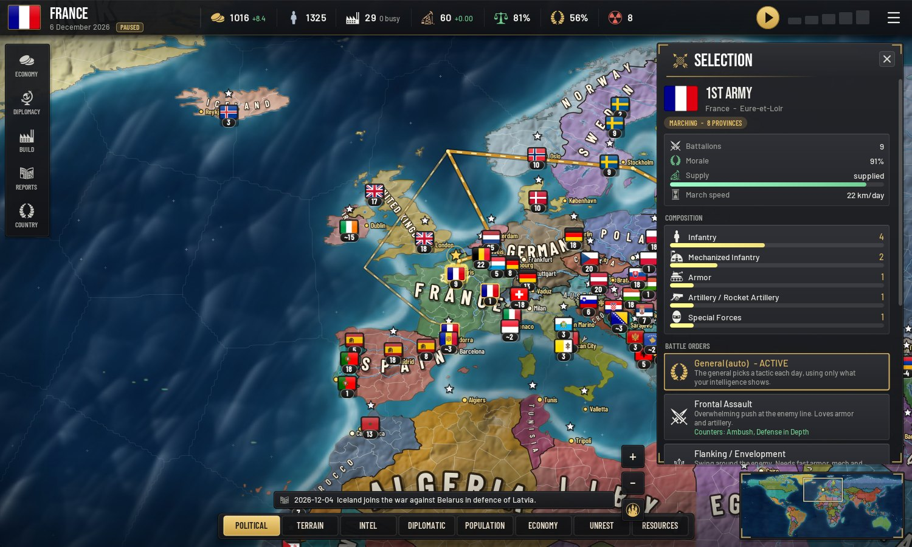
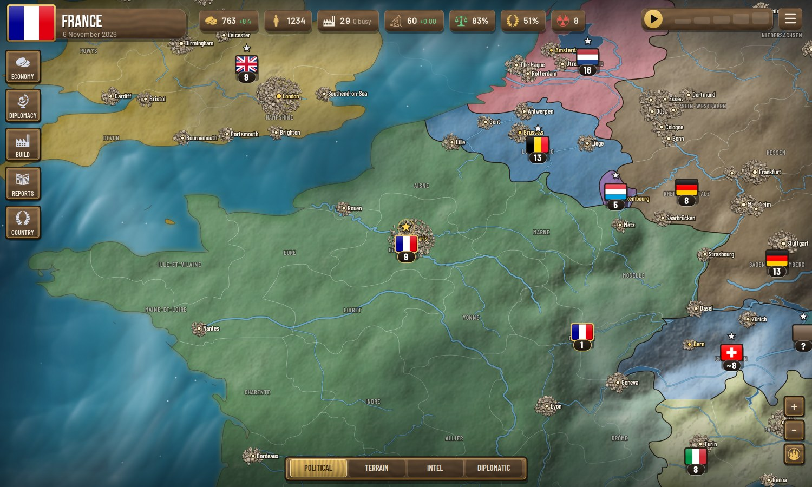
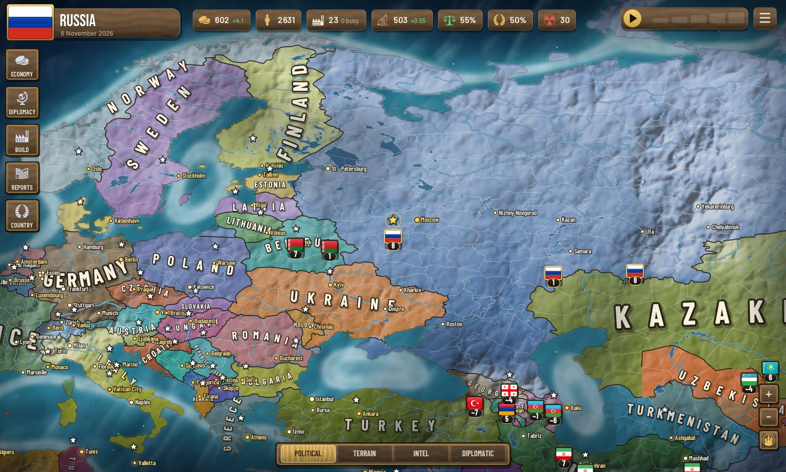
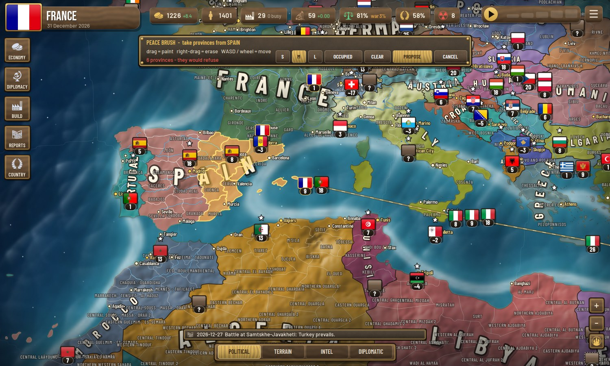
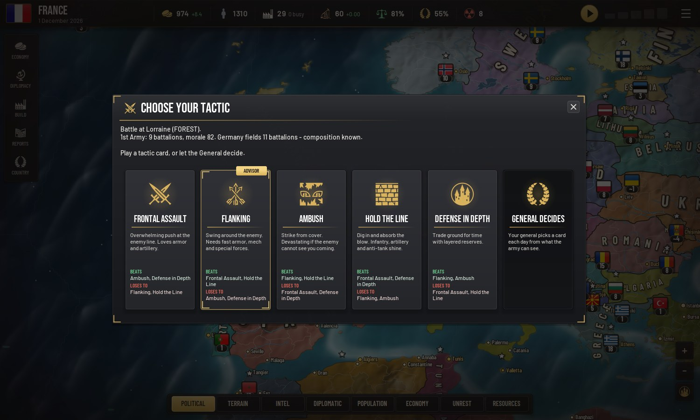
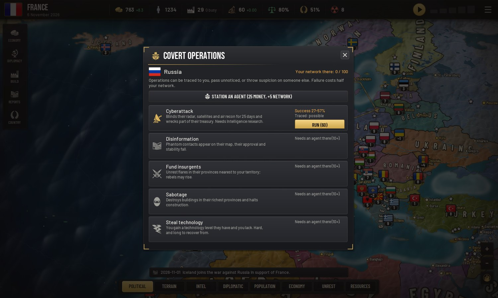
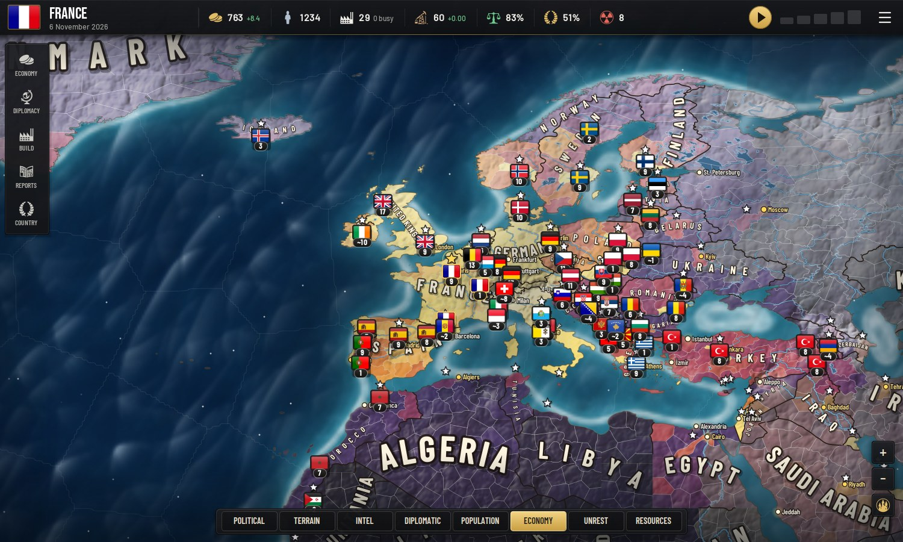
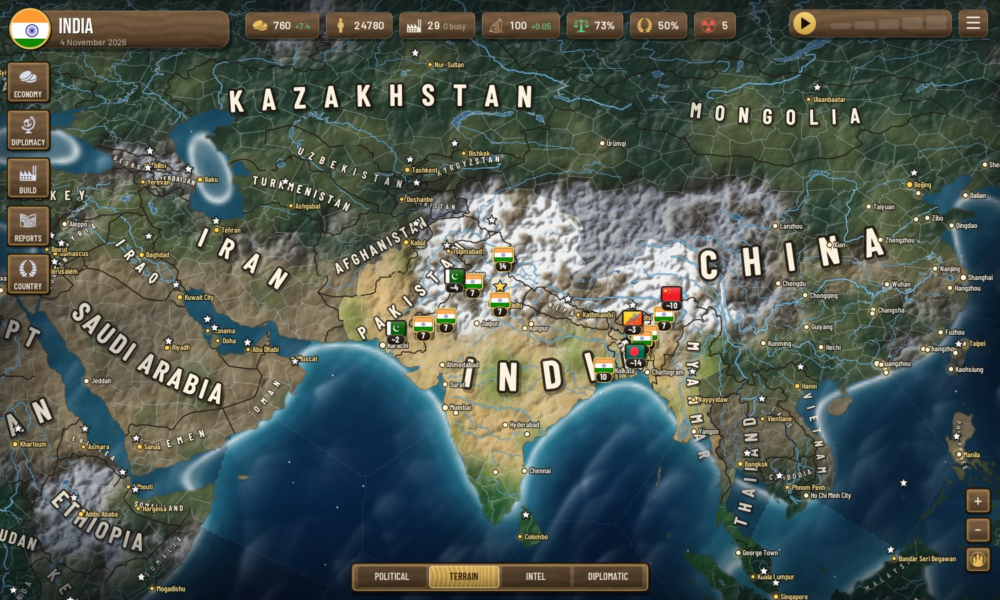
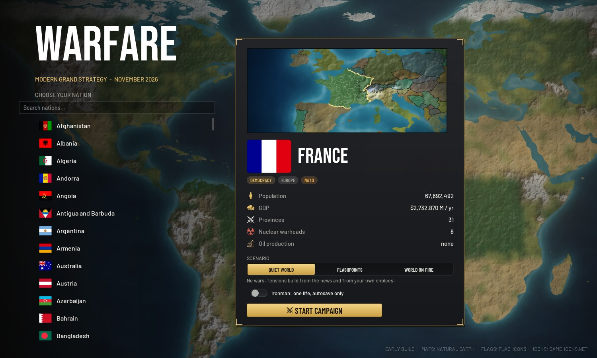
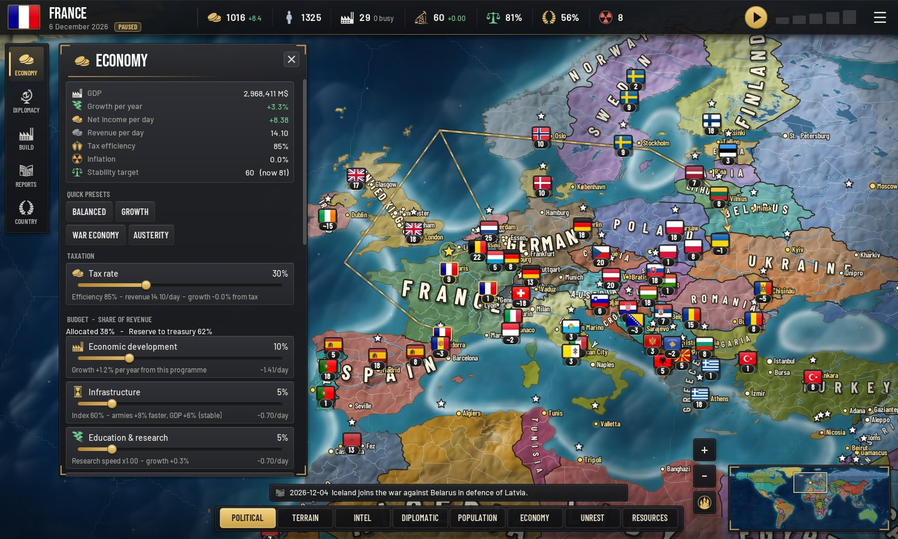
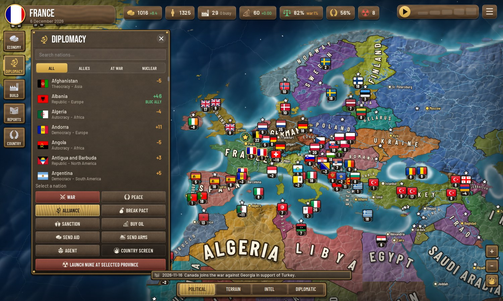
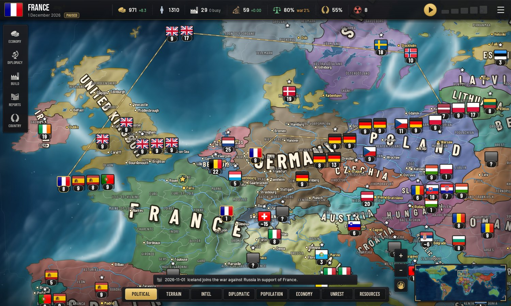
